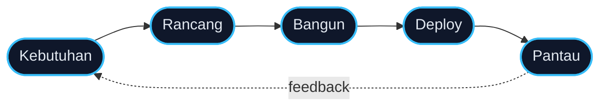
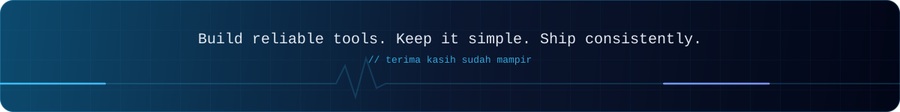

<div align="center">



<a href="https://github.com/ibrahim742">
  
</a>

<br/>


<a href="https://github.com/ibrahim742?tab=followers"></a>
<a href="https://github.com/ibrahim742?tab=repositories"></a>
<a href="https://github.com/ibrahim742"></a>

</div>

<br/>

## 👋 Tentang Saya

Saya membangun aplikasi web **dan** menjaga infrastruktur di baliknya. Dua sisi ini membuat saya terbiasa menelusuri masalah dari baris kode sampai ke jaringan: kalau sebuah sistem lambat atau mati, saya tahu harus mulai mencari dari mana.

```ts
const ibrahim = {
  role: "Full-Stack Web Developer",
  alsoDoing: "IT Support & Network Operations",
  strengths: [
    "Aplikasi web terstruktur (Laravel / NestJS)",
    "Integrasi API & notifikasi otomatis",
    "Pemantauan dan operasional jaringan",
    "Skrip otomasi & utilitas lokal",
  ],
  exploring: ["Arsitektur aplikasi", "Optimasi basis data", "Packaging tools"],
  principles: ["Keep it simple", "Reliability first", "Ship consistently"],
  openTo: ["Kolaborasi", "Proyek freelance", "Diskusi teknis"],
};
```

<br/>

## ⚙️ Cara Saya Bekerja



<br/>

## 🛠️ Tech Stack

<div align="center">

**Backend**<br/>


**Frontend**<br/>


**Database & Ops**<br/>


</div>

<br/>

## 🚀 Yang Saya Kerjakan

| | Area | Detail |
| :-: | :-- | :-- |
| 🌐 | **Web Development** | Aplikasi full-stack dengan arsitektur yang bersih dan mudah dirawat |
| 🔔 | **Otomasi & Integrasi** | Integrasi API, bot, dan notifikasi otomatis untuk alur kerja harian |
| 📡 | **Network Operations** | Monitoring, troubleshooting, dan menjaga uptime layanan |
| 🧰 | **Internal Tools** | Utilitas operasional dan skrip yang dipaketkan agar siap pakai |

<br/>

## 📊 GitHub Activity

<div align="center">


</div>

<br/>

## 🤝 Mari Terhubung

<div align="center">

<a href="https://github.com/ibrahim742"></a>

<br/><br/>



</div>
